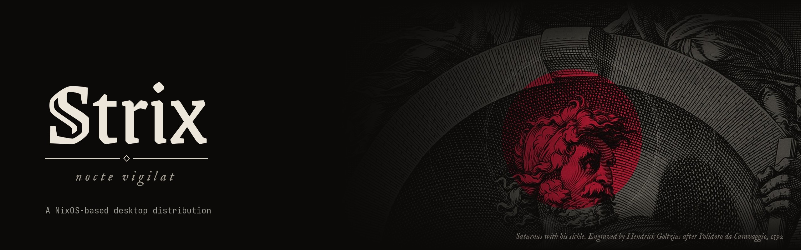

Strix is a NixOS-based system for people coming from Windows: NixOS without the terminal. You create the install stick on Windows with one click, install apps from the Store with one click, and change the look of the whole desktop with a theme.

```
Version :: 0.1.0, the desktop comes with 0.2.0
Base :: NixOS unstable
Desktop :: Hyprland, the shell in Quickshell
Themes :: the eight Roman gods of StrixUI, Saturnus first
State :: work in progress, tested on an old laptop
```

## The look

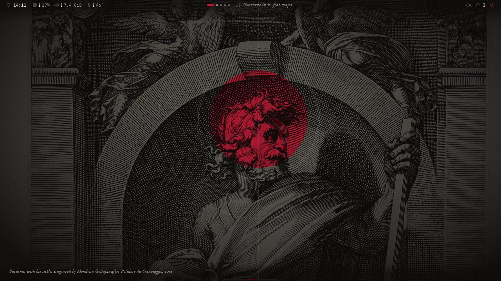

*Saturnus with his sickle. Engraved by Hendrick Goltzius after Polidoro da Caravaggio, 1592*

The look comes from [StrixUI](https://github.com/liviosysctl/StrixUI), the design system of Strix: near-black surfaces, old engravings of Roman gods as the ground, one accent colour that belongs to the god on the wallpaper, type from an old printing house beside a quiet monospace. Each god is a theme. Another god comes every 10 minutes unless you keep the one you have, and the lock screen shows a new one at every lock.

| | |
|---|---|
| 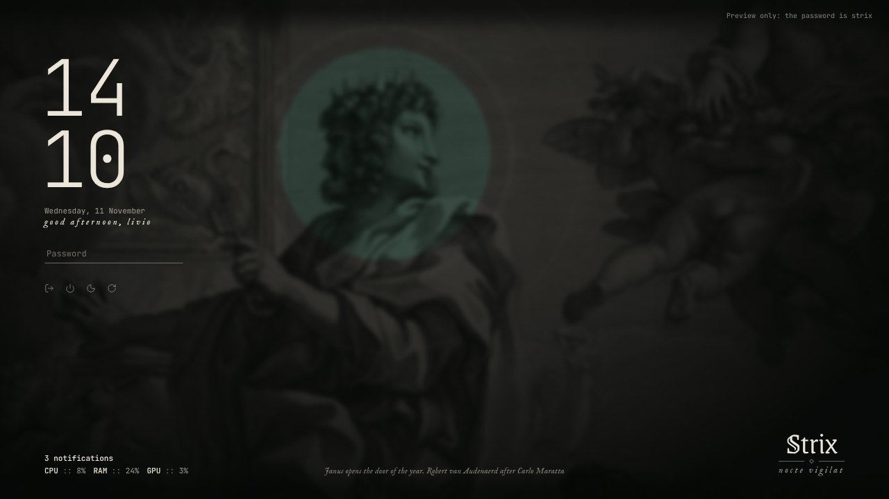 | 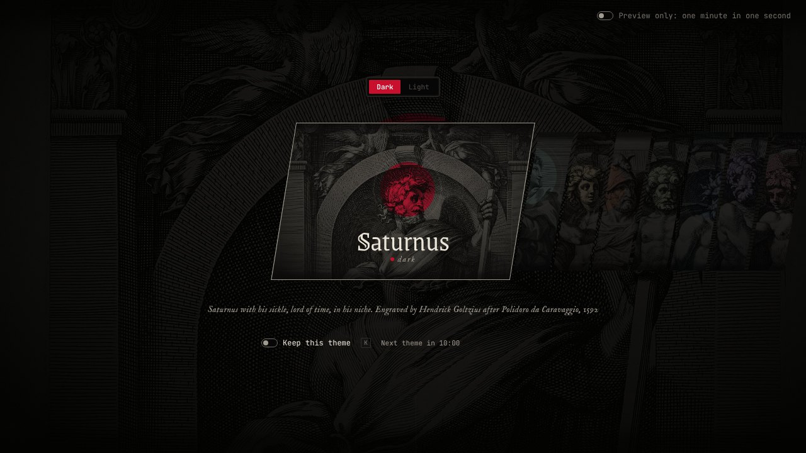 |
| *The lock screen* | *The theme picker* |
| 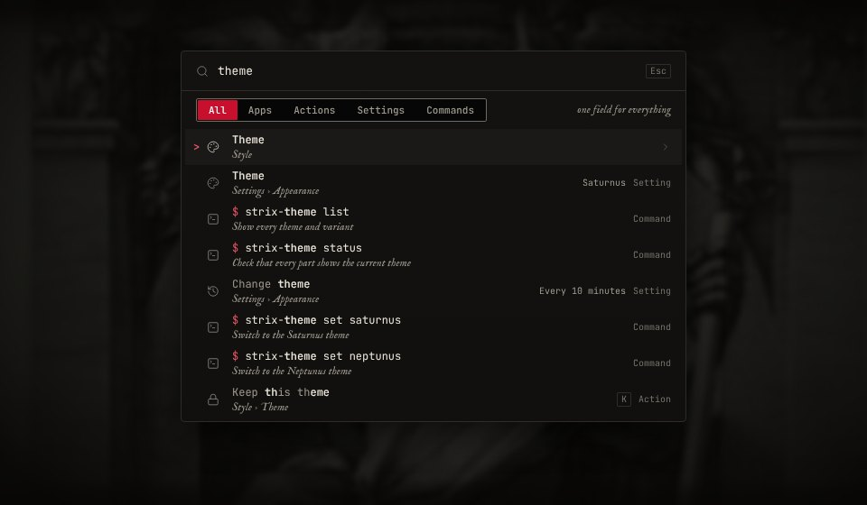 | 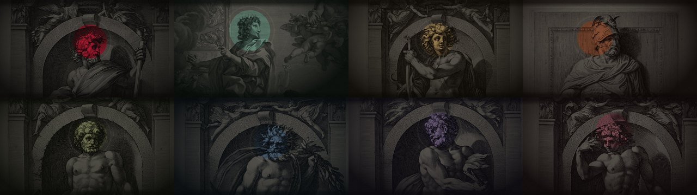 |
| *Search, one field for everything* | *Saturnus, Janus, Apollo, Mars, Vulcanus, Neptunus, Pluto and Bacchus* |

### More screens

| | |
|---|---|
| 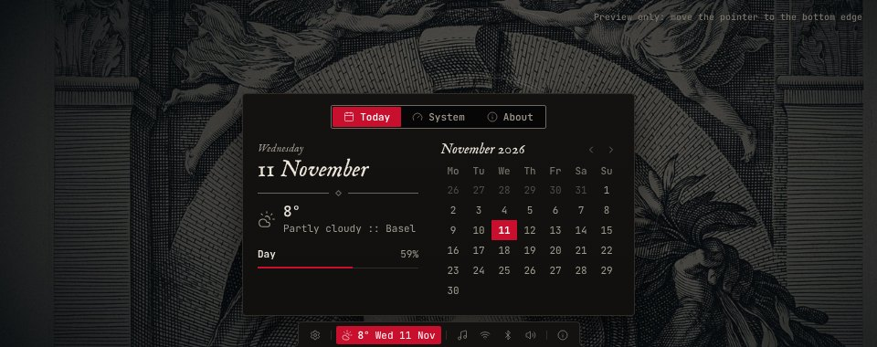 | 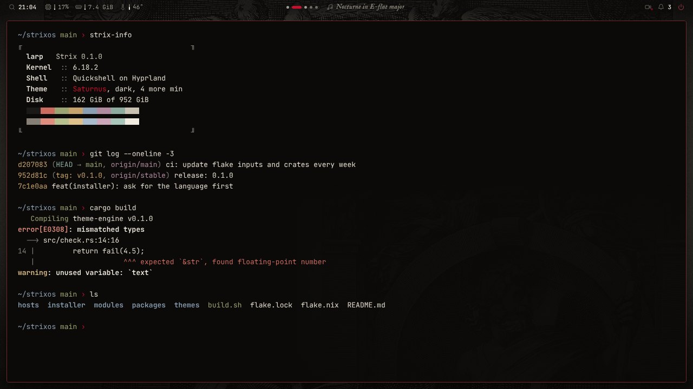 |
| *The dock* | *The terminal, Ghostty in the theme's colours* |
| 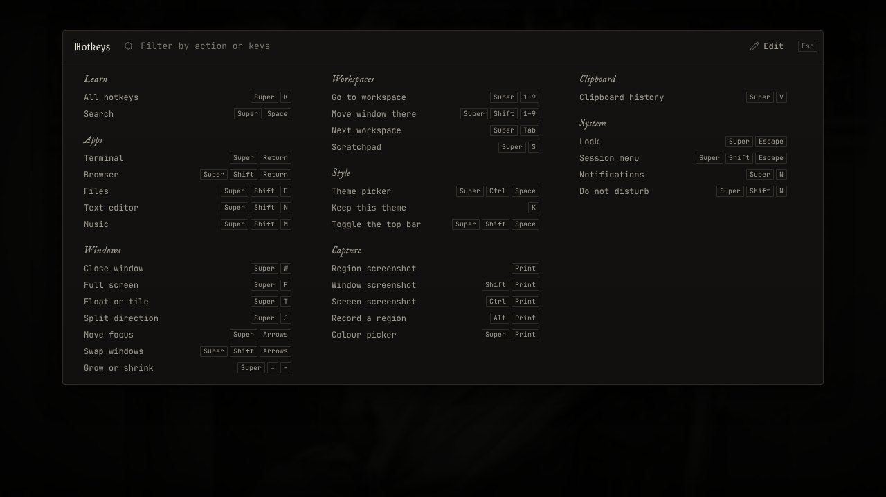 | 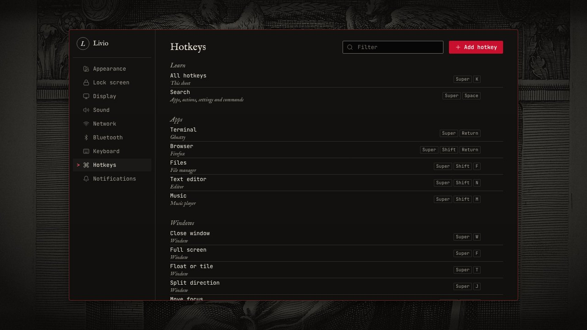 |
| *The cheat sheet, Super K* | *Settings, hotkeys* |
| 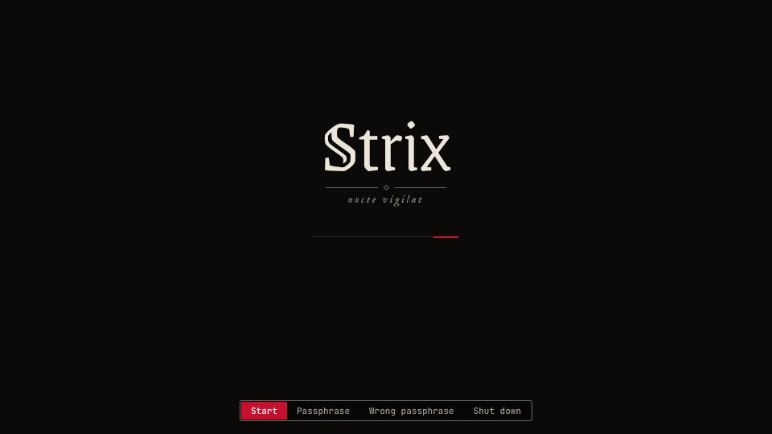 | 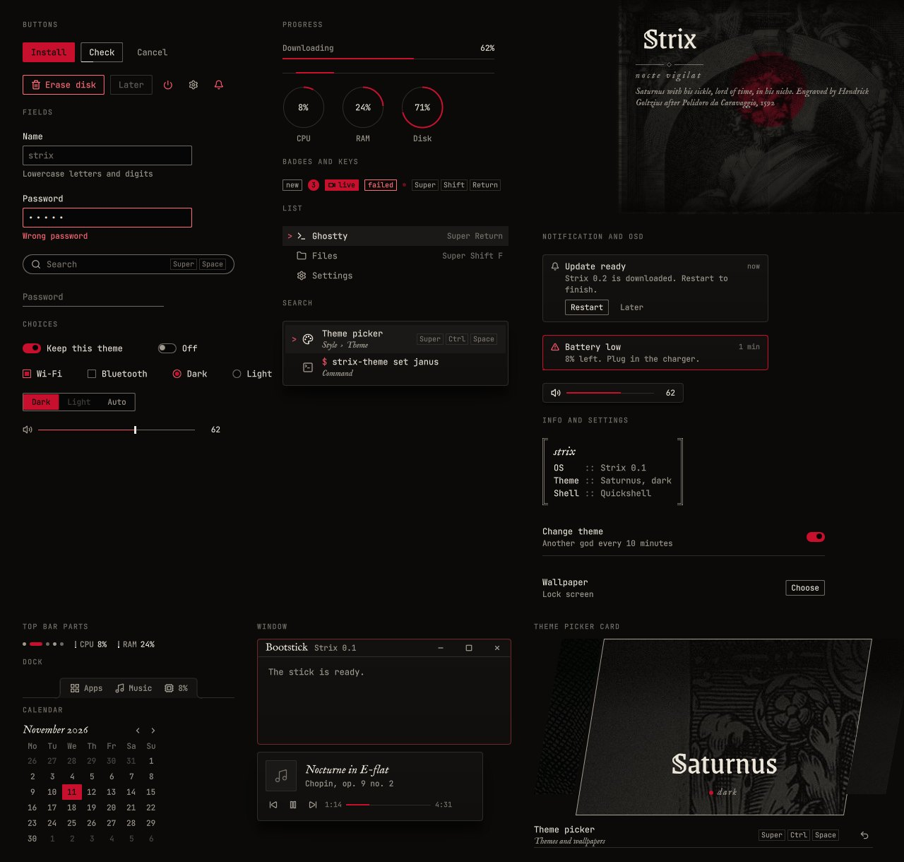 |
| *The boot splash* | *The QML components under Saturnus* |

These are renderings of the design from StrixUI; the shell in this repository is built from the same components. The dock is designed but not built yet. Sources and licences of every picture are in [docs/images/README.md](docs/images/README.md).

## Branches

| Branch | Content |
|---|---|
| `m245-poc` | This branch: the proof of concept for the school module M245. Windows bootstick app, app store, signed ISO, as little terminal as possible. Every push builds the signed ISO and publishes it as the pre-release `poc`, where the bootstick app downloads it; installed machines follow this branch. |
| `main` | The distribution itself. Releases (vX.Y.Z) come from there. |

## What is in the repository

| Path | Content |
|---|---|
| `branding.nix` | The only place the distro name appears. Everything else derives from it. |
| `lib/mk-system.nix` | `lib.mkSystem`: builds a machine from the files in `/etc/nixos`. |
| `modules/` | The distro modules: os-release, base system, the three tools, apps from `apps.json`, disk layout. |
| `modules/storage/btrfs.nix` | Disk layout with disko: GPT, ESP, optional LUKS, btrfs with flat subvolumes, Snapper for `/home`, hibernation. |
| `modules/boot-splash.nix` | Graphical boot with Plymouth: wordmark, progress line, a styled passphrase field. |
| `modules/theme.nix` | The theme engine on the system: the `strix-theme` command, the service that applies the theme at boot, the boot splash that follows it. |
| `themes/` | `default.nix`, the theme a new installation starts with (`saturnus`). The themes are the eight Roman gods of [StrixUI](https://github.com/liviosysctl/StrixUI), a flake input. [themes/README.md](themes/README.md) describes the format and the theme repositories. |
| `packages/theme-engine/` | The theme engine in Rust: reads and checks themes, switches them at runtime, fetches and checks theme repositories, writes the colours for Hyprland, Ghostty and GTK. |
| `packages/search/`, `modules/search.nix` | The search service behind Search and the cheat sheet: apps, the actions of `menu.toml`, every row of Settings, commands; it also makes the Hyprland keys and keeps the user's own keys. |
| `packages/store/`, `modules/store.nix` | The Store (`main` only): an index of the channel's packages, search, install and remove through `strix-apps`; proprietary apps ask first. |
| `packages/ui/`, `modules/ui.nix` | The design system of StrixUI on the machine: the QML module for Quickshell, the wallpapers, the fonts. |
| `modules/desktop.nix` | The desktop: Hyprland as a UWSM session, the login of Strix under greetd (or tuigreet), PipeWire, the apps of the cheat sheet, the shell as a user service, hypridle, and the session's theme service: another god every 10 minutes unless kept, Hyprland and Ghostty follow. |
| `shell/hypr/hyprland.lua` | The Hyprland configuration (Lua, Hyprland 0.55 and later): measures and motion of StrixUI; it requires `machine.lua`, `theme.lua` and `bindings.lua`, which Nix and the theme engine write. |
| `shell/qml/` | The shell in Quickshell from StrixUI's QML module: wallpaper, top bar (network, volume, battery, what is playing), lock screen, Search, cheat sheet, notifications, OSD for volume and brightness, clipboard history, theme picker, Settings, Store. `qs -c strix ipc show` lists what Hyprland can call. |
| `shell/greeter/` | The login screen in Quickshell, run by greetd in cage; it starts the same UWSM session. |
| `shell/settings.toml` | The pages and rows of Settings as Search finds them. |
| `shell/menu.toml` | The system menu of Search and every key of the cheat sheet; `strix-search bindings` makes the Hyprland keybindings from it. |
| `lib/themes.nix` | Themes at build time: the checked themes folder, a Plymouth theme per variant, the installer's colors. |
| `packages/plymouth-theme/` | Builds the Plymouth theme of one theme variant. |
| `templates/machine/` | Template for `/etc/nixos` that the installer fills in. |
| `hosts/` | A made-up machine for CI and testing: `reference`. |
| `iso/default.nix` | The installer ISO, built on the minimal NixOS installer. |
| `iso/live.nix` | The live session of the ISO: a slim Strix desktop, logged in at once, the graphical installer in front. |
| `installer/` | `strix-install`: asks a few questions in the console, then partitions, encrypts and installs. `--core --answers FILE` installs without asking. |
| `installer/gui/` | The graphical installer, built like Fedora's: a window in Quickshell with StrixUI that only asks, and a back end (`backend.py`) that knows the computer and runs `strix-install --core`. |
| `tests/` | Checks for `nix flake check`. |
| `flake.nix` | Version, modules, machines, the ISO, checks and a dev shell. |

## On an installed machine

`/etc/nixos` holds `flake.nix`, `flake.lock`, `hardware.nix`, `machine.nix` and `apps.json`, and once a theme repository is connected `themes.json` and `themes/`. These commands work with it:

| Command | Does |
|---|---|
| `sudo strix-rebuild [switch\|boot\|test\|build]` | Rebuilds from `/etc/nixos` |
| `sudo strix-update` | Fetches the newest release and every connected theme repository and switches to them, keeps the old version if the build fails |
| `sudo strix-update --themes [REPO]` | Only the theme repositories, or the one named |
| `sudo strix-apps add\|remove <package>`, `strix-apps list` | Installs or removes a package from nixpkgs. This is what the Store calls. |
| `sudo strix-theme set <theme>`, `strix-theme list` | Switches the theme without a rebuild, see [themes/README.md](themes/README.md). |
| `sudo strix-theme repos add <owner/repo>`, `strix-theme repos list` | Connects a theme repository; `strix-rebuild switch` builds its themes in, every `strix-update` brings new versions |
| `strix-settings [PAGE [ROW]]` | Opens Settings: `themes`, `network`, `bluetooth`, `sound`, `display`, `power`, `hotkeys`, `about` |
| `strix-capture region\|window\|screen\|record\|colour` | Screenshots to `~/Pictures/Screenshots` and the clipboard, a recording to `~/Videos/Recordings`, the colour picker; Print and its modifiers call it |
| Super Space | Search: apps, actions, settings and commands in one field; "Store" opens the Store |
| Super K | The cheat sheet with every key; change them in Settings › Hotkeys |
| Super V | The clipboard history |
| Super Ctrl Space | The theme picker; K keeps the theme, otherwise another god comes every 10 minutes |

SSH is on: `ssh <user>@<address>` with the user's password. Root cannot log in. To turn it off, add `services.openssh.enable = false;` to `machine.nix` and rebuild.

## Planned

- Release 0.2.0 with the desktop, after the tests on the laptop
- The bootstick app for Windows (a repository of its own)
- A signed ISO, so it boots with Secure Boot on

## Building the ISO

Needs Nix with flakes on Linux (NixOS-WSL works) and about 20 GB of free disk.

```sh
nix build .#iso-dev -L    # faster compression, for testing
nix build .#iso -L        # release compression
ls -lh result/iso/
```

Machines installed from either ISO follow the branch `m245-poc` and get every change with `strix-update`. CI builds, signs and publishes the ISO on every push to `m245-poc` (the pre-release `poc`).

The ISO starts into a slim Strix desktop with the installer's window in front. Closing the window only hides it: the card in the middle of the desktop, or Search ("Install"), opens it again. The console installer is still there: `sudo strix-install` on another console (Ctrl+Alt+F2).

The ISO boots on UEFI with Secure Boot off. Write it to a USB stick as a raw image, not by copying files onto a FAT32 stick.

Commit and push before building a release ISO. Only an ISO from a clean tree with a `flake.lock` pins the installed system to its own commit; from a dirty tree the installer locks during the install and needs the network for it.

## Installing

Boot the ISO: the installer's window opens by itself. Language and keyboard, the network (Wi-Fi right there if there is no cable), time zone, disk with encryption and hibernation, you and the computer, a summary; it only starts after you tick that the disk will be erased. The whole disk is used. The window shows each step, and at the end the code for Secure Boot when it is on.

The same questions in the console, for SSH or a machine without graphics:

```sh
sudo strix-install
```

It asks for the language first, and every screen after that is in German, French, Italian or English. Then keyboard, time zone, name, user, password, computer name, disk, encryption and hibernation, a summary, and it only starts after you type the disk's name. Both installers end the same way (`strix-install --core`). The log ends up in `/var/log/strix-install.log` on the installed system.

SSH already runs on the live system. To install over SSH, set a password with `passwd`, look up the address with `ip -4 addr` and connect with `ssh nixos@<address>`.

## Development

```sh
nix develop
```

The dev shell activates the commit hook and has the Rust tools for the theme engine. Commit and release rules are in [CONTRIBUTING.md](CONTRIBUTING.md).

```sh
nix flake check                                       # fast checks, also run by CI on every push
(cd packages/theme-engine && cargo test && cargo clippy --all-targets -- -D warnings)
nix build .#tests.theme -L                            # the theme engine in a VM, needs KVM
nix build .#tests.install -L                          # install on an empty disk and boot it, needs KVM
```

### The pre-release `poc`

No version tags on this branch. Every push to `m245-poc` replaces the pre-release `poc`: the signed ISO (in parts if larger than 2 GiB), `SHA256SUMS` and `manifest.json`, which the bootstick app reads. Releases of the distribution come from `main`.
