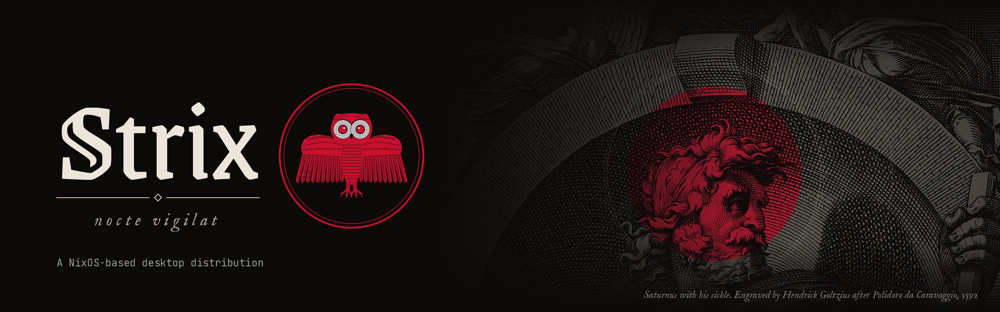
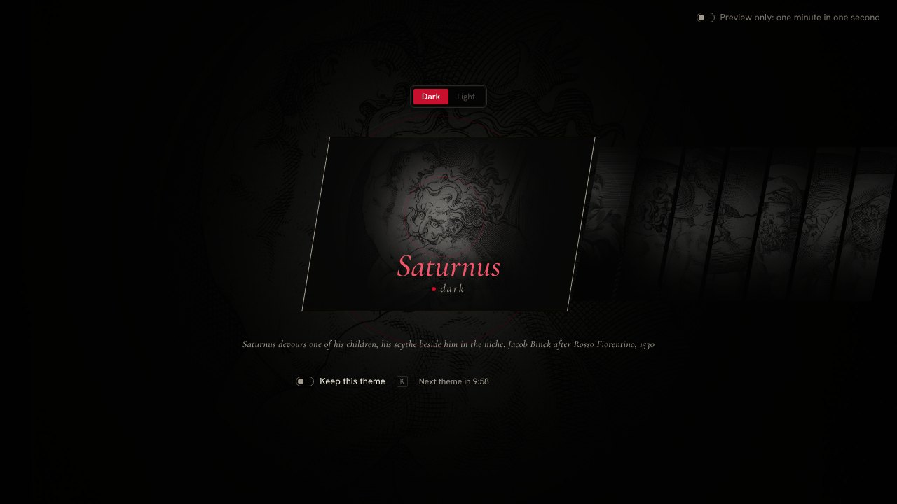
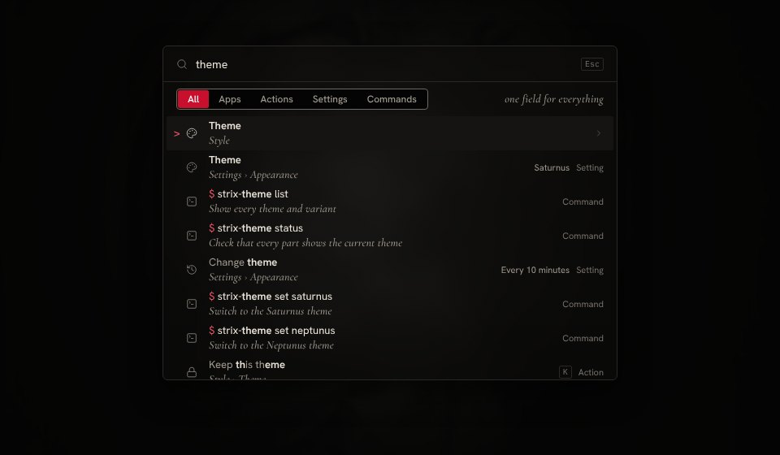
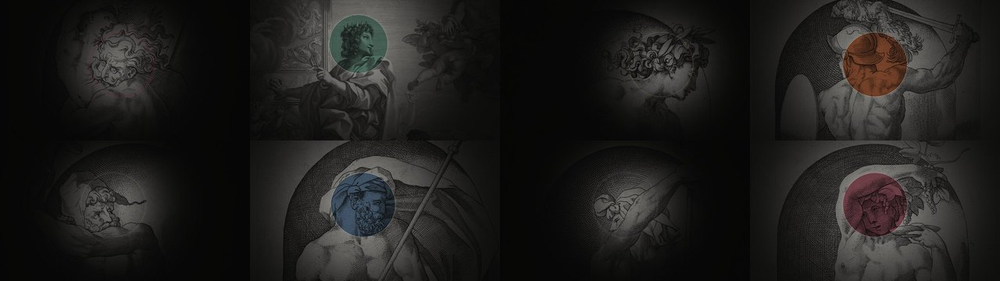
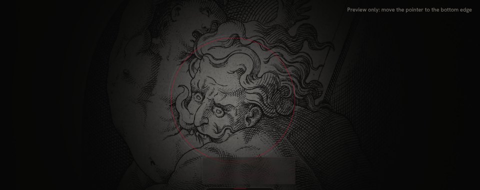
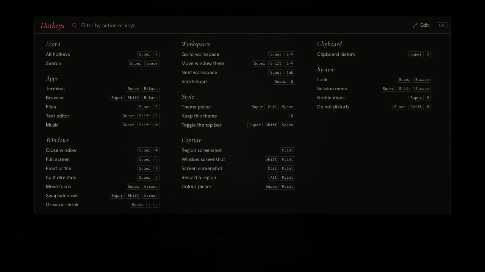

Strix is a NixOS-based desktop distribution: Hyprland with a shell of its own in Quickshell, own services in Rust, and one theme that reaches every part of the system, from the boot splash to the terminal. The machine is described in `/etc/nixos`, three commands rebuild, update and add apps, and Neovim is the editor for all of it.

```
Version :: 0.8.0
Base :: NixOS unstable
Desktop :: Hyprland, the shell in Quickshell
Themes :: the eight Roman gods of StrixUI, each dark and light, Saturnus first
State :: work in progress, tested on an old laptop
```

## The look


The look comes from [StrixUI](https://github.com/liviosysctl/StrixUI), the design system of Strix. Every Roman god is a theme with a dark and a light variant. Another god comes every 10 minutes unless you keep the one you have, and the lock screen shows a new one at every lock.

| | |
|---|---|
|  |  |
|  |  |
|  |  |
|  |  |

Sources and licences of every picture are in [docs/images/README.md](docs/images/README.md).

## Branches

| Branch | Content |
|---|---|
| `main` | The distribution. Releases come from here. |
| `m245-poc` | The proof of concept for the school module M245, based on 0.2.0. Its ISOs are built from the branch, not released. |

## What is in the repository

| Path | Content |
|---|---|
| `branding.nix` | The only place the distro name appears. Everything else derives from it. |
| `lib/mk-system.nix` | `lib.mkSystem`: builds a machine from the files in `/etc/nixos`. |
| `modules/` | The distro modules, a folder per area and a `default.nix` in each that lists its files: `core` (what every machine has: os-release, base system, the binary cache, the tools), `boot`, `hardware` (firmware, the newest kernel, memory, heat), `storage`, `desktop` (the session of a user), `apps` (the terminal's tools, Neovim, the packages of `apps.json`, nix-ld for programs built for other systems). |
| `modules/storage/btrfs.nix` | Disk layout with disko: GPT, ESP, optional LUKS, btrfs with flat subvolumes, Snapper for `/home`, hibernation. |
| `modules/boot/loader.nix` | GRUB as the boot loader: hidden menu, shown for a few seconds when Windows or another system is found; drawn in the selected theme. |
| `modules/boot/splash.nix` | Graphical boot with Plymouth: wordmark, progress line, a styled passphrase field. |
| `modules/desktop/theme.nix` | The theme engine on the system: the `strix-theme` command, the service that applies the theme at boot, the boot splash that follows it. |
| `themes/` | `default.nix`, the theme a new installation starts with (`saturnus`). The themes are the eight Roman gods of [StrixUI](https://github.com/liviosysctl/StrixUI), a flake input, each in a dark and a light variant. [themes/README.md](themes/README.md) describes the format and the theme repositories. |
| `packages/theme-engine/` | The theme engine in Rust: reads and checks themes, switches them at runtime, fetches and checks theme repositories, writes the colours for Hyprland, Ghostty and GTK, the effect of the terminal, and the pointer of every god. |
| `packages/search/`, `modules/desktop/search.nix` | The search service behind Search and the cheat sheet: apps, the actions of `menu.toml`, every row of Settings, commands; it also makes the Hyprland keys and keeps the user's own keys. |
| `packages/desk/` | The commands of the desktop in Rust: `strix-capture` (screenshots, recordings, the colour picker), `strix-idle` (what happens when nobody is at the machine), `strix-monitor` (btop in the colors of the theme), for Settings `strix-defaults` (which app opens what), `strix-storage` (what the disk holds) and `strix-printers`, and `strix-automount` (sticks and cards mount by themselves). |
| `packages/ui/`, `modules/desktop/ui.nix` | The design system of StrixUI on the machine: the QML module for Quickshell, the wallpapers, the fonts. |
| `modules/desktop/` | The desktop, one file per part (`hyprland.nix`, `login.nix`, `shell.nix`, `look.nix`, `theme-session.nix`, `power.nix`, `files.nix` and so on): Hyprland as a UWSM session, the login of Strix under greetd (or tuigreet), PipeWire, the apps of the cheat sheet, the shell as a user service, hypridle, and the session's theme service: another god every 10 minutes unless kept, Hyprland, Ghostty, the folders and the pointer follow. |
| `shell/hypr/hyprland.lua` | The Hyprland configuration (Lua, Hyprland 0.55 and later): measures and motion of StrixUI; it requires `machine.lua`, `theme.lua` and `bindings.lua`, which Nix and the theme engine write. |
| `shell/qml/` | The shell in Quickshell from StrixUI's QML module: wallpaper with the clock of the desktop, top bar, dock (tools, what is playing, its sound as bars), lock screen, Search, cheat sheet, overview of the workspaces, notifications, OSD for volume and brightness, clipboard history, theme picker, Settings, the password window of polkit. `qs -c strix ipc show` lists what Hyprland can call. |
| `shell/greeter/` | The login screen in Quickshell, run by greetd in cage; it starts the same UWSM session. |
| `shell/settings.toml` | The pages and rows of Settings as Search finds them. |
| `shell/menu.toml` | The system menu of Search and every key of the cheat sheet; `strix-search bindings` makes the Hyprland keybindings from it. |
| `lib/themes.nix` | Themes at build time: the checked themes folder, a Plymouth and a GRUB theme per variant, the owl in every variant. |
| `packages/plymouth-theme/` | Builds the Plymouth theme of one theme variant. |
| `packages/grub-theme/` | Builds the GRUB theme of one theme variant: the god's wallpaper, wordmark and motto, the menu in the look of StrixUI. |
| `templates/machine/` | Template for `/etc/nixos` that the installer fills in. |
| `hosts/` | A made-up machine for CI and testing: `reference`. |
| `iso/default.nix` | The installer ISO, built on the minimal NixOS installer. |
| `iso/live.nix` | The live session of the ISO: a slim Strix desktop, logged in at once, the graphical installer in front. |
| `installer/` | `strix-install` (Rust): the back end of the graphical installer (`--serve`), which knows the computer, and the core that partitions, encrypts and installs from an answers file (`--core --answers FILE`). |
| `installer/gui/` | The window of the graphical installer, built like Fedora's: Quickshell with StrixUI, it only asks. |
| `tests/` | Checks for `nix flake check`. |
| `flake.nix` | Version, modules, machines, the ISO, checks and a dev shell. |

## On an installed machine

`/etc/nixos` holds `flake.nix`, `flake.lock`, `hardware.nix`, `machine.nix` and `apps.json`, and once a theme repository is connected `themes.json` and `themes/`. These commands work with it:

| Command | Does |
|---|---|
| `sudo strix-rebuild [switch\|boot\|test\|build]` | Rebuilds from `/etc/nixos`. In a terminal it shows the build as a tree and then what changes against the running system, package by package |
| `sudo strix-update` | Fetches the newest release and every connected theme repository and switches to them, keeps the old version if the build fails |
| `sudo strix-update --themes [REPO]` | Only the theme repositories, or the one named |
| `strix-generations [list\|diff [N]]`, `sudo strix-generations switch N\|clean` | The versions of the system still installed, what one changed against the one before it, going back to one, tidying up |
| `strix-doctor [--report]` | Looks the system over (services, disk space, updates and caches, the shell, Hyprland's configuration, portal, sound) and says what is wrong; `--report` packs the checks and the logs of this start into one archive to send along with a question |
| `, <command>` | Runs a program that is not installed, once (comma); a command that is not there names the package that has it |
| `sudo strix-apps add\|remove <package>`, `strix-apps list` | Installs or removes a package from nixpkgs (kept in `/etc/nixos/apps.json`) and rebuilds. |
| `sudo strix-theme set <theme>`, `strix-theme list` | Switches the theme without a rebuild, see [themes/README.md](themes/README.md). |
| `sudo strix-theme repos add <owner/repo>`, `strix-theme repos list` | Connects a theme repository; `strix-rebuild switch` builds its themes in, every `strix-update` brings new versions |
| `strix-settings [PAGE [ROW]]` | Opens Settings: `themes`, `network`, `bluetooth`, `sound`, `display`, `input`, `power`, `hotkeys`, `account`, `time`, `apps`, `storage`, `printers`, `versions`, `about` |
| `strix-capture region\|window\|screen\|annotate\|text\|record\|colour` | Screenshots to `~/Pictures/Screenshots` and the clipboard, one to draw on first (Satty), the text of a region into the clipboard, a recording to `~/Videos/Recordings`, the colour picker; Print and its modifiers call it |
| Super Space | Search: apps, actions, settings and commands in one field |
| Super K | The cheat sheet with every key; change them in Settings › Hotkeys |
| Super V | The clipboard history |
| Super G | The theme picker; K keeps the theme, otherwise another god comes every 10 minutes |
| Super L | Light or dark: the other variant of the theme, kept for every god after it |
| Super O | The overview: every workspace with its windows; drag a window onto another workspace |
| Super Drag, Super RightDrag | Move or resize a window with the mouse; Super and the wheel go through the workspaces |

SSH is on: `ssh <user>@<address>` with the user's password. Root cannot log in. To turn it off, add `services.openssh.enable = false;` to `machine.nix` and rebuild.

## Planned

- Nothing open right now; see the plan.

## Building the ISO

Needs Nix with flakes on Linux (NixOS-WSL works) and about 20 GB of free disk.

```sh
nix build .#iso-dev -L    # faster compression, for testing
nix build .#iso -L        # release compression
ls -lh result/iso/
```

Machines installed from `iso` follow the branch `stable`, which only moves when a release is published. Machines installed from `iso-dev` follow `main` and get every fix with `strix-update`. CI builds an `iso-dev` on every push to `main` (Actions, the run, "Artifacts").

The ISO starts into a slim Strix desktop with the installer's window in front. Closing the window only hides it: the card in the middle of the desktop, or Search ("Install"), opens it again.

The ISO boots on UEFI. Release ISOs are signed and also boot with Secure Boot on: the first start shows MokManager once, choose "Enroll key from disk" and `strix.cer` from the stick ([secure-boot/README.md](secure-boot/README.md)). An ISO from `nix build` is unsigned and needs Secure Boot off. Write it to a USB stick as a raw image (`dd`), not by copying files onto a FAT32 stick.

Commit and push before building a release ISO. Only an ISO from a clean tree with a `flake.lock` pins the installed system to its own commit; from a dirty tree the installer locks during the install and needs the network for it.

## Installing

Boot the ISO: the installer's window opens by itself. Language and keyboard, the network (Wi-Fi right there if there is no cable), time zone, disk, encryption and hibernation, you and the computer, a summary; it only starts after you tick what will be erased. The window shows each step, and at the end the code for Secure Boot when it is on.

Strix takes the whole disk, or one partition or free space on it, next to Windows: shrink C: in Windows first (Disk Management), leave the space free or make it a D:, then pick that in the installer. Only the chosen partition is deleted; Strix makes its own ESP and system partition there, and Windows keeps its own ESP. Windows itself, its ESP, recovery and reserved partitions, BitLocker volumes and anything in use show in the list but cannot be picked. GRUB finds Windows and shows its menu for a few seconds at every start.

The window speaks German, French, Italian and English. Underneath it runs `strix-install --core`, which installs from an answers file without asking; the log ends up in `/var/log/strix-install.log` on the installed system.

Without a screen, over SSH (set a password with `passwd`, find the address with `ip -4 addr`, connect with `ssh nixos@<address>`), the core runs on its own. The answers are the window's, the password goes into `/run/strix-install/user.pass` and, with encryption, the passphrase into `/tmp/strix-luks.key`:

```sh
sudo strix-install --facts                  # the disks with their partitions, memory, Secure Boot
sudo strix-install --core --answers answers.json
```

```json
{
  "hostName": "laptop", "timeZone": "Europe/Zurich", "locale": "de_CH.UTF-8", "keyboard": "ch",
  "user": { "name": "livio", "fullName": "Livio" },
  "disk": "/dev/disk/by-id/nvme-...", "encrypt": true, "hibernation": false
}
```

Without `space` the whole disk is used. Next to Windows, `"space": { "start": ..., "end": ... }` names a partition or free space by its first and last sector, as `--facts` lists them under the disk's `spaces`.

## Development

```sh
nix develop
```

The dev shell activates the commit hook and has the Rust tools for the theme engine. Commit and release rules are in [CONTRIBUTING.md](CONTRIBUTING.md).

```sh
nix flake check                                       # fast checks, also run by CI on every push
(cd packages/theme-engine && cargo test && cargo clippy --all-targets -- -D warnings)
nix build .#tests.theme -L                            # the theme engine in a VM, needs KVM
nix build .#tests.install -L                          # install on an empty disk and boot it, needs KVM
```

### Releasing

Same flow as the other repositories (CONTRIBUTING.md): bump the version in `flake.nix`, commit `chore(release): vX.Y.Z`, push an annotated tag. The release workflow then creates the release with the notes, builds and signs the ISO, attaches it with `SHA256SUMS`, and moves `stable` to the tag. The ISO stays below 2 GiB, the most GitHub takes per file, because it does not carry the installed system: the installer downloads it. Should it ever grow past that, the workflow attaches it in parts; join them with `cat strix-*.iso.part* > strix.iso` and check with `sha256sum -c SHA256SUMS`.

Before tagging, try the packaging without a release: Actions, "Release", "Run workflow". The files land in the run as an artifact.
